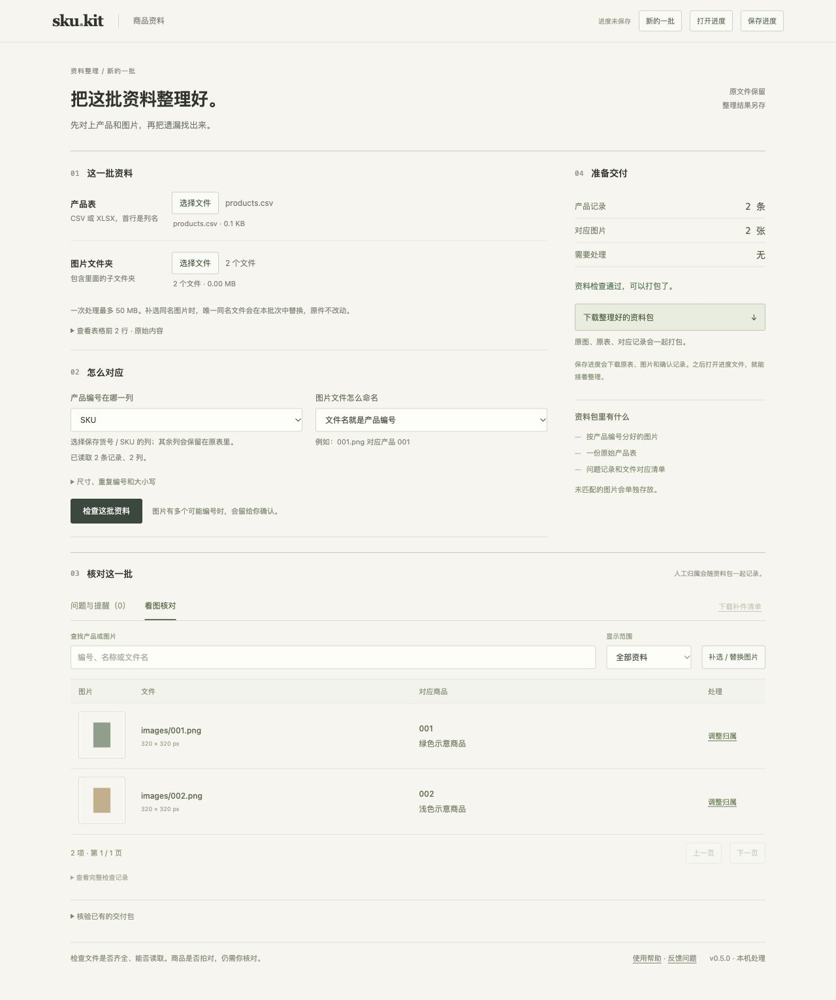

# SKU Kit

**Match product spreadsheets with images before handing them over.**

[中文](README.md) · [Download previews](https://github.com/Yixun-ai/-/releases) · [Report an issue](https://github.com/Yixun-ai/-/issues/new/choose)

SKU Kit helps people who receive a supplier's spreadsheet and a folder of product photos. It finds missing images, duplicate product IDs, unreadable files, and ambiguous matches. Review thumbnails, confirm assignments, then export the original files organized by product ID, together with a checklist and audit records.

Processing runs on your computer. No model API key, paid AI service, or cloud upload is required. Matching an ID does not prove that a photo shows the correct product. Blocking errors prevent export.

The web interface is currently **in Chinese**. This English page describes the project and its entry points; it does not indicate a fully translated interface.

## Choose an entry point

| What you want to do | Where to start |
| --- | --- |
| Organize product data without installing Python | [Desktop preview downloads](https://github.com/Yixun-ai/-/releases) |
| Try a small synthetic example | [Quick start and optional demo](docs/quickstart.md) — Chinese guide |
| Automate checks or connect an AI host | [Install from source](#install-from-source), then use CLI / HTTP / MCP |
| Contribute or ask for help | [Contributing](CONTRIBUTING.md) · [Support](SUPPORT.md) |



The screenshot uses synthetic placeholders, not customer data. The workbench starts empty; example files are a separate, optional download.

## What it does

- Reads CSV and standard XLSX; lets you select a worksheet and product-ID column and preview the first three rows.
- Matches filenames to product IDs. Optional suffix rules must be enabled explicitly; ambiguous matches require review.
- Reports missing or damaged images, duplicate IDs, and unmatched files; exports a missing-material checklist.
- Supports manual image assignments, replacement images, and progress files for continuing later.
- Exports original table and image bytes with paths, SHA-256 hashes, rules, and assignment records.
- Verifies an existing SKU Kit delivery ZIP for missing, changed, or inconsistent files.
- Uses one checking engine for the local web interface, CLI, HTTP API, and stdio MCP adapter.

## Desktop downloads

Open [Releases](https://github.com/Yixun-ai/-/releases) and read the selected preview's notes and checksums. Preview releases are not marked as GitHub's stable `Latest` release.

- Windows Intel / AMD x64: `SKU-Kit-windows-amd64.zip`.
- Mac Apple Silicon: `SKU-Kit-darwin-arm64.zip`. This download does not support Intel Macs.
- Optional synthetic example: `SKU-Kit-demo.zip`, when listed with the release.

Extract the entire program ZIP before starting. On Windows, run `Start SKU Kit.bat`; on Mac, run `Start SKU Kit.command`. Keep the `_internal` directory and terminal window. Your browser opens a local address; press Ctrl+C in the terminal to stop the service.

These previews are not commercially code-signed or notarized for macOS. Compatibility and validation are described in each release's notes. See [desktop details](docs/desktop.md) and [troubleshooting](docs/troubleshooting.md), currently in Chinese. Do not disable system-wide security settings to start the app.

## Install from source

Current source version: **0.5.0**. Requires **Python 3.11+** and Pillow 13. Node.js is only needed for JavaScript development tests.

Clone the repository and enter its root:

```sh
git clone https://github.com/Yixun-ai/-.git sku-kit-project
cd sku-kit-project
```

macOS / Linux:

```sh
python3 -m venv .venv
.venv/bin/python -m pip install .
.venv/bin/sku-kit
```

Windows Command Prompt:

```bat
py -3 -m venv .venv
.venv\Scripts\python.exe -m pip install .
.venv\Scripts\sku-kit.exe
```

Use a Python 3.11 or newer interpreter when creating the environment. Installing dependencies initially requires network access unless you already have them locally.

The installation provides `sku-kit` for the local web app, `sku-kit-cli` for JSON CLI output, and `sku-kit-mcp` for stdio MCP. In an activated environment, `python -m sku_kit` also starts the app. If a release includes a wheel, install that local file in your environment instead.

**This project has not been published to PyPI. `pip install sku-kit` is not this project's documented download command.** The repository currently retains the name `-`; the clone command above is intentional.

Source files live in `sku-kit/`. The existing source-directory workflow remains available: install `requirements.txt` and run `python3 server.py` from that directory. See the [detailed guide](sku-kit/README.md).

## CLI and AI integration

In an activated installation environment, replace these paths with your own:

```sh
sku-kit-cli check --table /data/products.csv --images /data/images --sku-column SKU
sku-kit-cli checklist --table /data/products.csv --images /data/images --output /data/missing.csv
sku-kit-cli pack --table /data/products.csv --images /data/images --output /data/delivery.zip
sku-kit-cli verify --package /data/delivery.zip
```

Standard output is UTF-8 JSON. Exit code `0` means success, `2` means findings or failed verification, and `1` means invalid input or a runtime failure. Existing output files are not overwritten. Warnings require explicit acceptance before packing; blocking errors cannot be bypassed.

An AI host needs local command execution, local HTTP access, or a compatible local MCP connection. A normal chat page cannot directly read your local files. Compatibility has not been tested with every AI client. See the [API reference](sku-kit/API.md) and [Skill entry](sku-kit/skills/sku-kit/SKILL.md), currently in Chinese.

## Limits and data handling

- Web input: 50 MB of original data. CLI images: 240 MB total. ZIP verification: 70 MB in the browser; 320 MB compressed and expanded in the CLI. Other file and row limits are in the [usage guide](sku-kit/README.md).
- Supports CSV and standard XLSX. Does not extract embedded Excel images or read XLS or encrypted spreadsheets.
- Product IDs should be stored as text. Lost leading zeros or numeric precision cannot be recovered; formulas are not accepted as product IDs.
- Saved `.sku-kit.json` progress files contain the original table, images, and decisions. Keep them in your own business-data directory. The application does not automatically persist batches or collect usage telemetry.
- Hash manifests are not digital signatures. Verification does not establish the sender's identity or the correctness of the photographed products, and does not replace a marketplace's review process.

## Project maintenance

[Contributing](CONTRIBUTING.md) · [Code of conduct](CODE_OF_CONDUCT.md) · [Support](SUPPORT.md) · [Security](SECURITY.md) · [Changelog](CHANGELOG.md) · [Validation record](sku-kit/验证记录.md)

Check the actual [CI runs](https://github.com/Yixun-ai/-/actions/workflows/ci.yml) and [desktop build runs](https://github.com/Yixun-ai/-/actions/workflows/desktop.yml) for the selected revision. Automated checks do not guarantee that all systems, inputs, or AI clients work without errors. Use synthetic or sanitized reproductions in public reports; never upload customer tables, original photos, progress files, or secrets.

## License

[MIT License](LICENSE), Copyright (c) 2026 Yixun-ai. Use, modification, redistribution, and commercial use are permitted with the required notices retained. Dependencies retain their own licenses.
