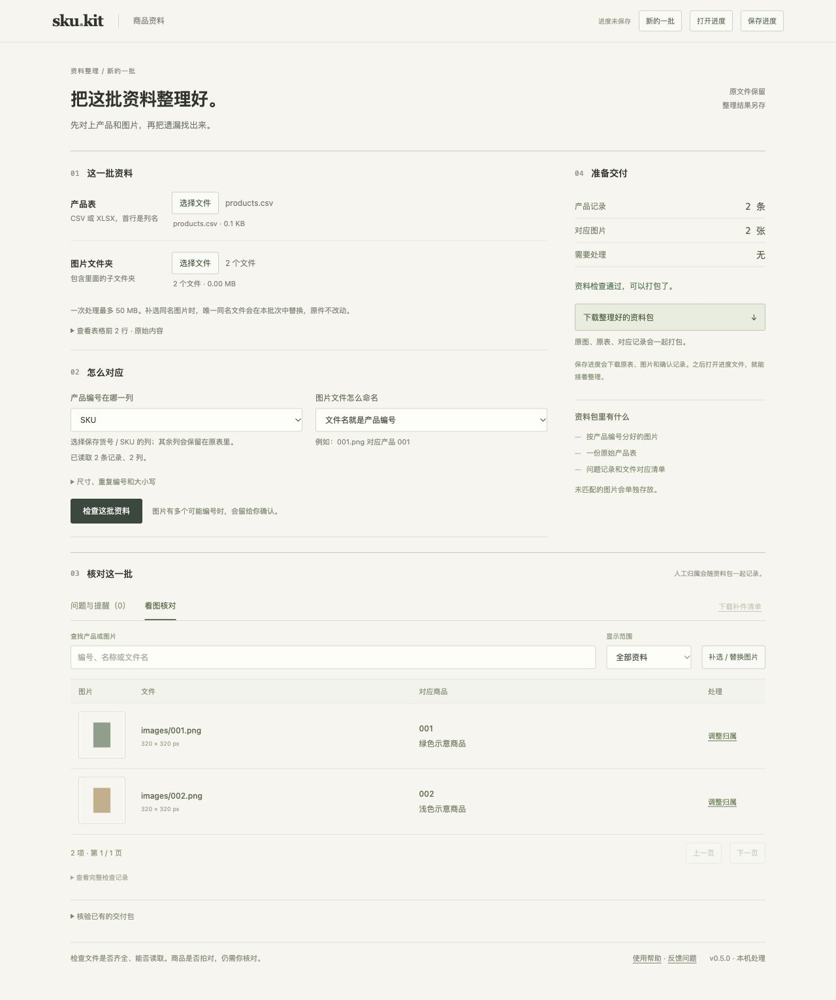

# SKU Kit

**商品资料交付前，把产品表和图片对上。**

[English](README.en.md) · [下载预览版](https://github.com/Yixun-ai/-/releases) · [两分钟上手](docs/quickstart.md) · [反馈问题](https://github.com/Yixun-ai/-/issues/new/choose)

[](https://github.com/Yixun-ai/-/actions/workflows/ci.yml)
[](https://github.com/Yixun-ai/-/actions/workflows/desktop.yml)

供应商发来一张 Excel 和一个图片文件夹，哪些商品缺图、哪些编号重复、哪些图片无法读取？SKU Kit 在本机检查这些问题，让你看图确认有歧义的归属，再导出按编号整理的原图、原表和检查记录。

不用模型 API Key，不修改原件，不把资料上传到云端。**能对上编号，不代表商品拍对了；有阻断错误，就不能强制生成交付包。**

## 从哪里开始

| 你的用途 | 入口 |
| --- | --- |
| 直接整理商品资料 | [下载 Windows / macOS 桌面预览版](https://github.com/Yixun-ai/-/releases)，无需安装 Python |
| 先看实际操作 | [合成示例与两分钟指南](docs/quickstart.md)，示例独立下载，工作台默认空白 |
| 用脚本或 AI 宿主调用 | [安装源码包](#安装源码包) → CLI / HTTP / MCP |
| 报错、建议、参与开发 | [问题反馈](https://github.com/Yixun-ai/-/issues/new/choose) · [贡献指南](CONTRIBUTING.md) |



截图中的商品和图片均为合成占位资料，不包含客户数据。网页界面目前为中文，另提供英文项目说明。

## 可以完成什么

- 读取 CSV / XLSX，直接选择工作表和编号列，查看前 3 行预览。
- 按编号匹配图片；后缀模式需要明确开启，多编号命中时交给人确认。
- 查出缺图、损坏图片、重复编号和多余文件，导出补件清单。
- 看缩略图调整归属，补选 / 替换图片，保存进度后继续。
- 导出保留原始字节的资料包，记录路径、SHA-256、规则和人工确认。
- 独立核验收到的 SKU Kit ZIP，发现文件缺失、改动或清单不一致。
- 网页、CLI、HTTP、MCP 共用一个检查引擎。

## 桌面下载

打开 [Releases](https://github.com/Yixun-ai/-/releases)，选择一个经过构建验证的预览版：

- **Windows Intel / AMD 64 位**：`SKU-Kit-windows-amd64.zip`。
- **Mac Apple Silicon（M 系列）**：`SKU-Kit-darwin-arm64.zip`，不适用于 Intel Mac。
- **可选合成示例**：`SKU-Kit-demo.zip`，不会自动载入到工作台。

完整解压程序文件夹后，Windows 双击 `Start SKU Kit.bat`，Mac 双击 `Start SKU Kit.command`。保留 `_internal` 文件夹及启动终端。浏览器会打开仅本机可访问的地址，按 Ctrl+C 停止服务。

预览包未商业签名或 macOS 公证；系统兼容范围与验证结果以该版发布说明为准。[详细启动说明](docs/desktop.md) · [常见问题](docs/troubleshooting.md)

## 安装源码包

当前源码版本 **0.5.0**，需要 **Python 3.11+**。运行依赖只有 Pillow；0.5 起使用 Pillow 13 的安全修复基线。不需要 Node.js；Node.js 仅用于开发测试。

先克隆仓库并进入根目录：

```sh
git clone https://github.com/Yixun-ai/-.git sku-kit-project
cd sku-kit-project
```

macOS / Linux：

```sh
python3 -m venv .venv
.venv/bin/python -m pip install .
.venv/bin/sku-kit
```

Windows（CMD）：

```bat
py -3 -m venv .venv
.venv\Scripts\python.exe -m pip install .
.venv\Scripts\sku-kit.exe
```

安装后有 `sku-kit`（本机网页）、`sku-kit-cli`（JSON 命令行）和 `sku-kit-mcp`（stdio MCP）三个入口；在已激活环境中也可运行 `python -m sku_kit`。Release 若附带 wheel，可在虚拟环境中安装该文件。**项目尚未发布到 PyPI，请不要把 `pip install sku-kit` 当作本项目的下载命令。**

旧版源码用法继续支持：进入 `sku-kit/` 后安装 `requirements.txt`，运行 `python3 server.py`。完整说明见[使用文档](sku-kit/README.md)。

## CLI 与 AI 调用

下面的命令在已激活的安装环境中执行，路径替换成自己的资料路径：

```sh
sku-kit-cli check --table /data/products.csv --images /data/images --sku-column SKU
sku-kit-cli checklist --table /data/products.csv --images /data/images --output /data/补件.csv
sku-kit-cli pack --table /data/products.csv --images /data/images --output /data/delivery.zip
sku-kit-cli verify --package /data/delivery.zip
```

stdout 是 UTF-8 JSON；退出码 0 表示成功，2 表示有检查问题或核验未通过，1 表示输入或运行失败。已有输出不覆盖；仅有提醒时需明确确认后导出，阻断错误不能绕过。

可执行命令、调用本机 HTTP 或连接本地 MCP 的 AI 宿主可接入。普通聊天页面无法直接读取本机文件，也没有“所有 AI 客户端均已实测”的承诺。[接口说明](sku-kit/API.md) · [Skill 入口](sku-kit/skills/sku-kit/SKILL.md)

## 边界与数据

- 网页原始资料总量最多 50 MB；CLI 图片总量 240 MB。ZIP 核验网页上限 70 MB，CLI 压缩与展开总量各 320 MB；数量和单文件限制见[使用说明](sku-kit/README.md)。
- 支持 CSV、标准 XLSX 和列出的图片格式；不提取 Excel 内嵌图片，不支持 XLS 或加密表。
- Excel 已丢失的前导零或数字精度不能恢复。编号应为文本；公式不作为产品编号。
- 保存的 `.sku-kit.json` 包含原表、原图及确认记录，请保存在自己的业务目录。应用不自动持久化或收集使用数据。
- 核验清单不是数字签名；它不能证明发送者身份，也不能证明图片中的商品正确或满足平台审核规则。

## 维护与贡献

[贡献指南](CONTRIBUTING.md) · [行为准则](CODE_OF_CONDUCT.md) · [支持范围](SUPPORT.md) · [安全报告](SECURITY.md) · [版本记录](CHANGELOG.md) · [已有验证](sku-kit/验证记录.md)

CI 对 Windows、macOS、Linux 运行源码、JavaScript 与安装包检查；桌面构建还会解压最终 ZIP，实际启动并验证检查、导出和篡改拦截。请以链接中的运行结果为准，测试通过不等于零错误保证。反馈问题时请用合成或脱敏资料复现，不要上传客户表、原图、进度文件或密钥。

## 许可

[MIT License](LICENSE) · Copyright (c) 2026 Yixun-ai。允许使用、修改、分发和商用，分发时保留版权及许可声明。依赖软件遵循各自许可证。
